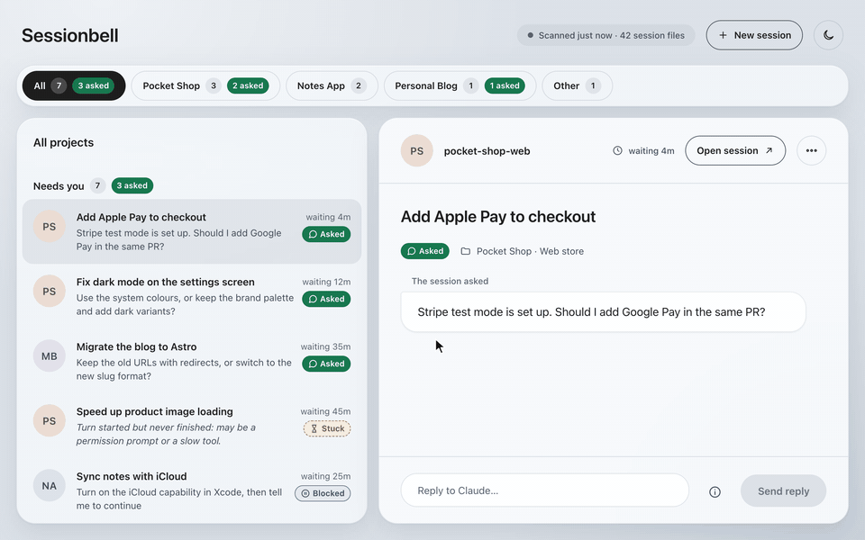
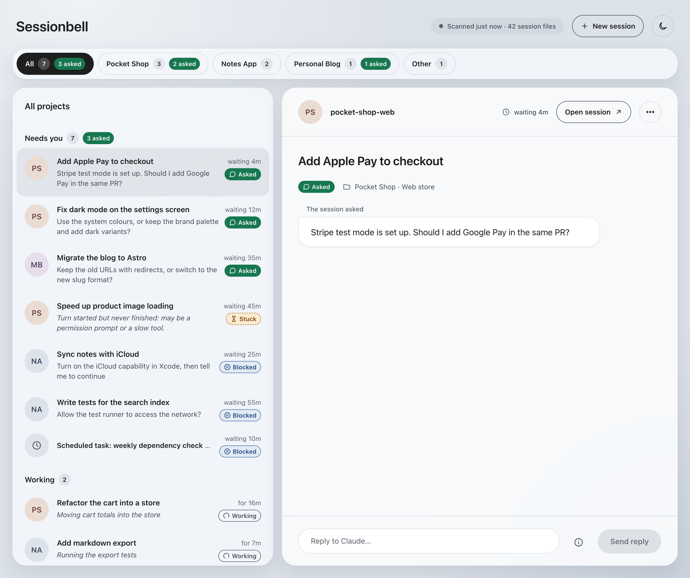
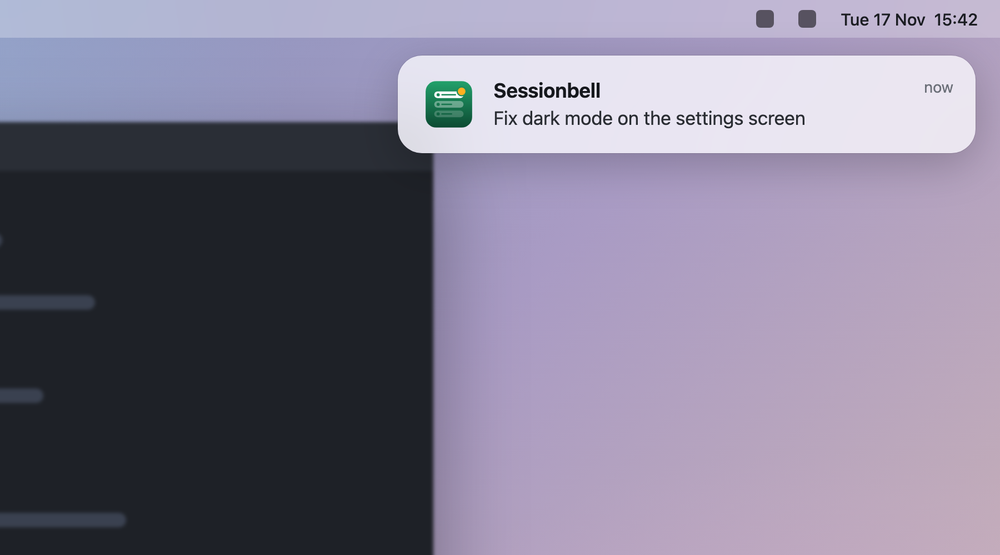

# Sessionbell

See which Claude Code sessions are waiting on you. An independent tool, not affiliated with Anthropic.

If you run a lot of Claude Code sessions in the Claude desktop app, some of them stop and wait for you:
a question, a permission prompt, a finished turn to review. With ten sessions open, you click through the
sidebar to find them.

This is a small local dashboard that lists only the sessions waiting on you, says what each one wants, and
opens it in the Claude app with one click.

<!-- Images: made-up sessions only (tools/demo-fixture.json), never the live page. How to remake them:
     marketing/reddit-plan.md, "Images". -->
<p align="center">
  
</p>

## What it shows

<picture>
  <source media="(prefers-color-scheme: dark)" srcset="marketing/images/sessionbell-wide-dark.png">
  
</picture>

- **Needs you**: sessions that asked a question, are blocked on you, or look stuck (a turn started and went
  quiet for 30 minutes). Questions come first.
- **Working**: sessions still running, with the plan step they're on, so you know what's coming.
- **Scheduled tasks**: the latest run of each recurring task, when it needs you.
- **Stale**: sessions that have waited on you for over a week, folded away to archive or pick back up.
- **Quieter**: finished turns ready to review, and unread sessions.
- **Caught up**: finished sessions you've already read in the last week, folded away, so you can still open
  one again.
- Sessions grouped by project, using folder rules you write once.
- Snooze (1 hour, until tomorrow) and Dismiss, with Undo. A dismissed session comes back when it does
  something new.
- **Pin**: pin a session from its "More actions" menu and it keeps its place in the list, marked with a pin,
  even after you read it, until you unpin it.
- A macOS banner when a session asks something new, and a count in the tab title and Dock badge.
- An optional reply box that sends a short answer to the session without switching apps. It's **off by
  default**; see [Replying from the dashboard](#replying-from-the-dashboard).



The banner above is a mock-up. A real one shows Script Editor's icon, because macOS attributes it to
`osascript`.

## Privacy

- Everything runs on your Mac. The server listens on `127.0.0.1` only and refuses requests from other sites
  (Host, Origin and content-type checks on every write).
- No AI model is called and nothing is uploaded. Session titles and text never leave the machine.
- It only reads the Claude app's files. It never writes to `~/Library/Application Support/Claude/`.
- Python 3 standard library only, and the page is a single HTML file with no build step and no third-party
  scripts.

## Requirements

- macOS with the Claude desktop app, using sessions in its Code tab.
- `/usr/bin/python3` (Python 3.9 or newer, which comes with the Xcode command line tools).
- Chrome or Safari, if you want to install it as an app.

## Install

```bash
git clone https://github.com/raduzoom/sessionbell-for-claude.git
```

```bash
cd sessionbell-for-claude && ./install.sh
```

`install.sh` adds two LaunchAgents: the scanner runs every 10 seconds, and the server stays on. Both start
at login. Then open <http://127.0.0.1:8790>.

To check that both agents are running (each line shows a process id and a last exit status of `0`):

```bash
launchctl list | grep sessionbell
```

`install.sh` is safe to run again. Run it after you change `scanEverySeconds`. After you update the code,
restart the server so it loads the new version:

```bash
launchctl kickstart -k gui/$(id -u)/local.sessionbell.server
```

To install it as an app, open that address in Chrome and click the Install icon in the address bar, or in
Safari choose File → Add to Dock. Use `127.0.0.1`, not `localhost`.

To remove it, run `./uninstall.sh`. It stops both agents and moves their files to the Trash. Your settings
and `data/` stay where they are.

## Group sessions by project

Edit `projects.json` to name your projects and say which folders belong to each:

```json
{
  "projects": [
    {"id": "work", "name": "Work", "children": [{"id": "work/api", "name": "API"}]},
    {"id": "side", "name": "Side projects", "children": []},
    {"id": "other", "name": "Other", "children": []}
  ],
  "default": "other",
  "rules": [
    {"folder": "~/code/api", "project": "work", "subproject": "work/api"},
    {"folder": "~/code/blog", "project": "side", "subproject": null}
  ]
}
```

A session goes to the project whose folder contains its working folder. Anything else goes to `default`. To
see which folders have no rule yet, run this in your own terminal (it prints session titles):

```bash
python3 scanner.py --print
```

## Settings

`config.json`:

| Key | Default | What it does |
|---|---|---|
| `scanEverySeconds` | `10` | How often the scanner runs (5–120). Run `./install.sh` again after changing it. |
| `pageRefreshSeconds` | `5` | How often the page re-reads the list (2–300). Reload the page. |
| `replyEnabled` | `false` | Shows the reply box. See below. Reload the page. |

To change a setting on your Mac only, put it in `config.local.json` next to `config.json`, for example
`{"replyEnabled": true}`. Its keys win over `config.json`, and git ignores it, so an update never resets it.

## Replying from the dashboard

The Claude app has no API for sending a message, so the reply box works by remote-controlling the app:

1. The server opens the session through its `claude://` link and waits until the Claude app shows it.
2. It turns on the app's accessibility view (Claude is an Electron app, so macOS can't see its message box
   otherwise) and waits for the message box to have focus.
3. It types only when Claude is the frontmost app and the focused element is a text box. It pastes your
   reply and presses Return.
4. It puts your clipboard back, switches the accessibility view back off, and returns you to the app you
   were using.

Your text is passed to `osascript` as an argument, never written into the script. Only sessions currently
on the dashboard can receive a reply, it sends one reply at a time, and replies are limited to 4,000
characters.

Because it controls another app, it's off until you turn it on:

1. Create `config.local.json` next to `config.json` containing `{"replyEnabled": true}`, and reload the page.
2. The first time you send, macOS asks for two permissions for `python3`: **Accessibility** (called
   "Device Control and Data Access" on newer macOS) and **Automation → System Events**. If one is missing,
   the dashboard shows where to turn it on.

Set it back to `false` to turn it off. The server checks the setting on every send, so the change works
without a restart.

## Limits

- It reads the Claude app's internal session files, which are undocumented. A Claude update can change them
  and break the dashboard until it's fixed. When the format looks wrong, the page shows a red banner instead
  of reporting zero.
- It works on macOS only, for the desktop app's Code tab, on one Mac.
- Working out what a session is doing is a best guess from its files. "Stuck" means a turn went quiet for 30
  minutes, which can also be a very slow tool.

## Development

```bash
python3 -B -m unittest
```

```bash
python3 -I tools/snapshot.py
```

The tests use made-up data and never open a session or type into the app. `tools/snapshot.py` builds pages
from made-up data in `design/page-check/build/` for design checks and screenshots.

`data/` (status, snooze state, logs) holds real session titles. It's git-ignored: never commit it or share
screenshots of the live page.

## License

MIT. See [LICENSE](LICENSE).
